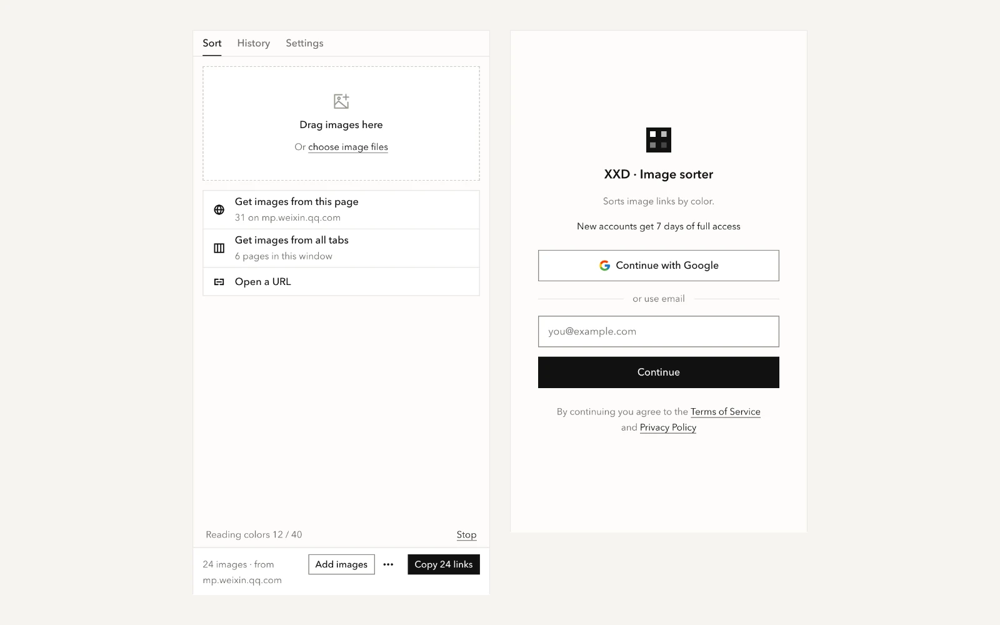
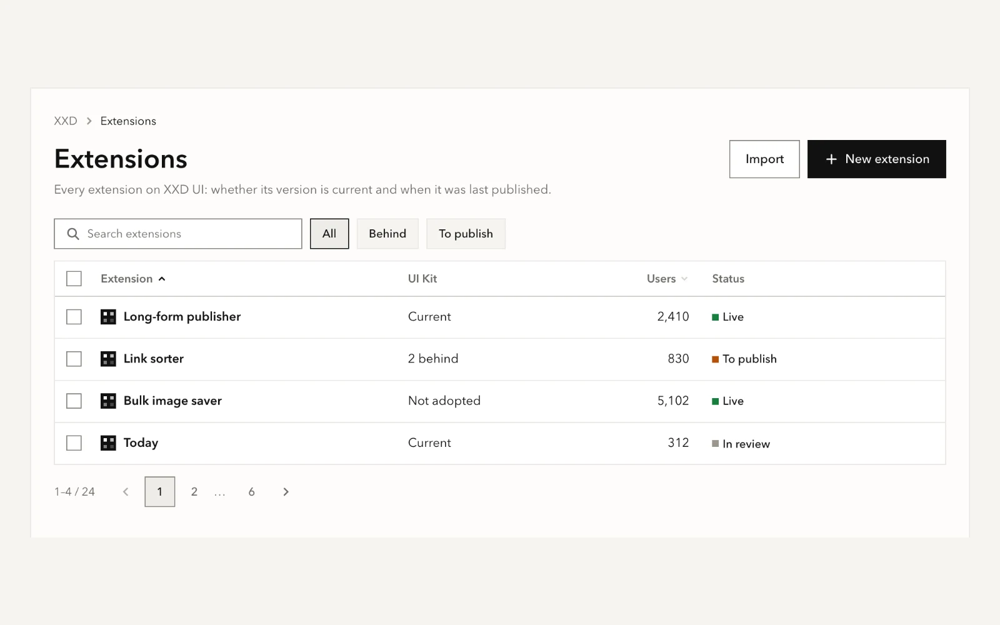
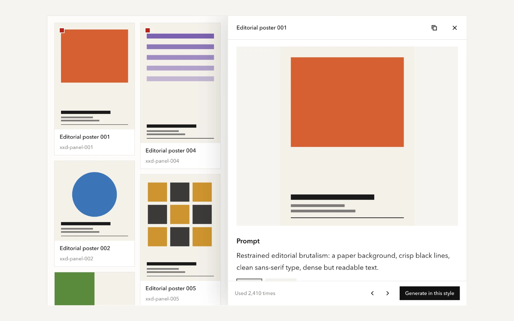
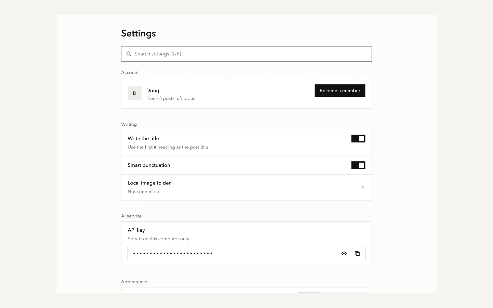
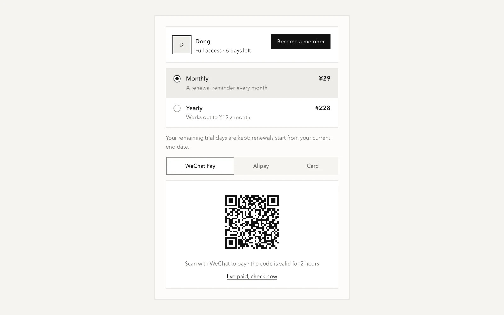
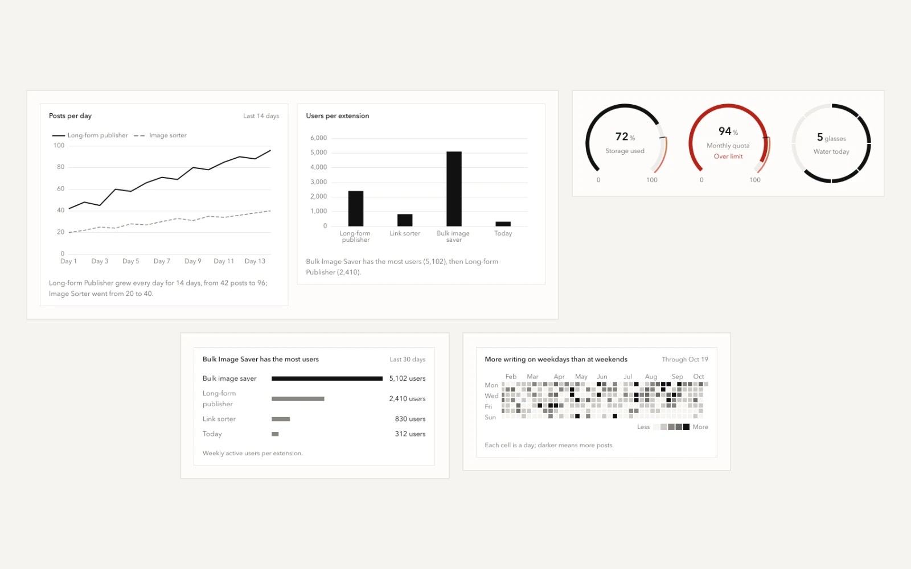
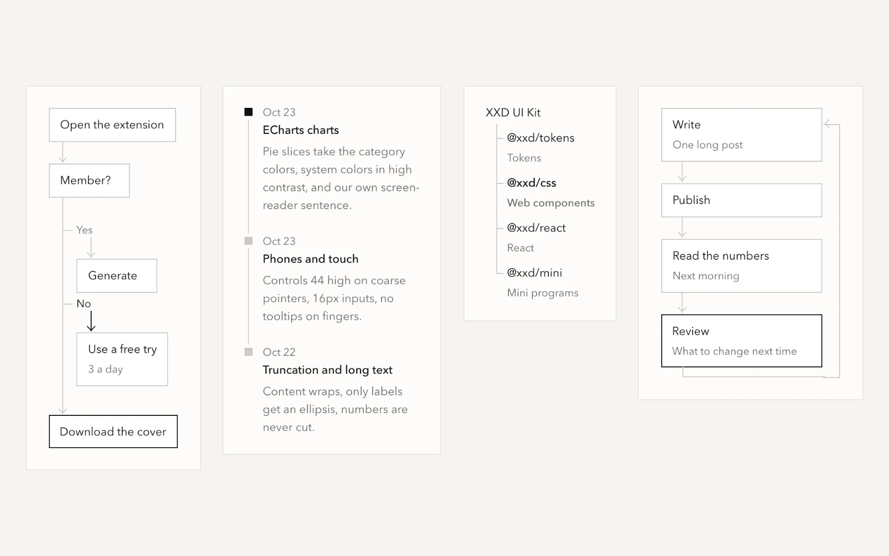
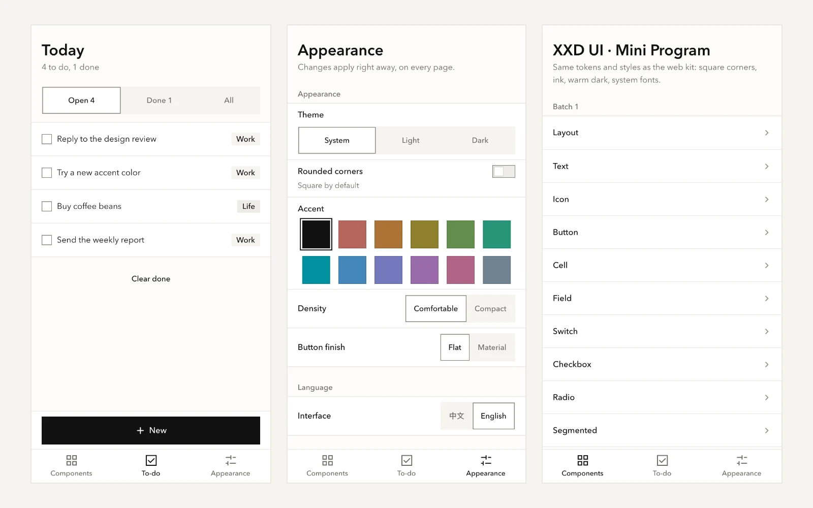

<div align="center">

# XXD UI Kit

**Build browser extensions, websites, admin pages and WeChat mini programs.<br>What you make looks polished, works well, and clearly belongs to one family.**

[](https://github.com/nevertoday/xxd-ui-kit/actions/workflows/xxd.yml) [](COMMERCIAL.en.md)   

**[See the showcase](https://ui.xiaoxiaodong.ai/en/) · [Get started](https://ui.xiaoxiaodong.ai/en/start) · [Design principles](https://ui.xiaoxiaodong.ai/en/principles) · [Changelog](CHANGELOG.en.md) · [Commercial license](COMMERCIAL.en.md)**

[中文](README.md) · **English**

<br>

<a href="https://ui.xiaoxiaodong.ai/en/">
  <picture>
    <source media="(prefers-color-scheme: dark)" srcset="docs/assets/readme/hero-dark.en.webp">
    
  </picture>
</a>

<sub>A website on the left, a Chrome extension in the middle, a WeChat mini program on the right. All three are built from the real components, not mockups.</sub>

</div>

<br>

## What it saves you

When you build a small product, the interface is often what drags. How tall is a button? How gray is secondary text? What does dark mode look like? Can people hit it with a finger? Where does an error message go? You answer these again for every new project, and after a few projects none of them look alike.

This kit has already answered them. You just put pages together:

- **Paste a few lines and go.** A plain web page needs one CSS file and one JS file. No Node, no bundler.
- **One look, everywhere.** Web pages, Chrome extensions, React and WeChat mini programs look the same. Change the accent or the corners and they all change.
- **AI writes it the same way.** It ships instructions for AI coding tools, so Claude Code, Cursor and the like follow the rules instead of making up colors.

All 14 of XXD's own extensions and sites use it. When a component changes, one command syncs every project.

## What you can build

Every picture below is a real page on the showcase. Click one to open it and copy the code.

<table>
<tr>
  <td width="50%"><a href="https://ui.xiaoxiaodong.ai/en/templates/extension-sidepanel"><picture><source media="(prefers-color-scheme: dark)" srcset="docs/assets/readme/use-extension-dark.en.webp"></picture></a><br><b>Browser extensions</b><br><sub>Side panel, popup, options page and sign-in, set up with one command.</sub></td>
  <td width="50%"><a href="https://ui.xiaoxiaodong.ai/en/templates/resource-list"><picture><source media="(prefers-color-scheme: dark)" srcset="docs/assets/readme/use-admin-dark.en.webp"></picture></a><br><b>Admin and management pages</b><br><sub>Search, filters, sorting, select all, pagination. Numbers align right and status reads at a glance.</sub></td>
</tr>
<tr>
  <td><a href="https://ui.xiaoxiaodong.ai/en/templates/detail-panel"><picture><source media="(prefers-color-scheme: dark)" srcset="docs/assets/readme/use-content-dark.en.webp"></picture></a><br><b>Image and content sites</b><br><sub>A masonry grid plus a detail panel. The interface steps back and lets the content lead.</sub></td>
  <td><a href="https://ui.xiaoxiaodong.ai/en/templates/settings"><picture><source media="(prefers-color-scheme: dark)" srcset="docs/assets/readme/use-settings-dark.en.webp"></picture></a><br><b>Settings pages</b><br><sub>Searchable settings, switches, a secret key field. It tells you whether a change was saved.</sub></td>
</tr>
<tr>
  <td><a href="https://ui.xiaoxiaodong.ai/en/patterns/membership"><picture><source media="(prefers-color-scheme: dark)" srcset="docs/assets/readme/use-pay-dark.en.webp"></picture></a><br><b>Sign-in and payments</b><br><sub>Membership plans and QR-code checkout with WeChat Pay and Alipay, the way Chinese products do it.</sub></td>
  <td><a href="https://ui.xiaoxiaodong.ai/en/components/chart"><picture><source media="(prefers-color-scheme: dark)" srcset="docs/assets/readme/use-data-dark.en.webp"></picture></a><br><b>Data and charts</b><br><sub>One call puts ECharts in the same colors. Plus 8 small charts: gauge, ranked bars, heatmap, radar and more.</sub></td>
</tr>
<tr>
  <td><a href="https://ui.xiaoxiaodong.ai/en/components/flowchart"><picture><source media="(prefers-color-scheme: dark)" srcset="docs/assets/readme/use-diagram-dark.en.webp"></picture></a><br><b>Flows and diagrams</b><br><sub>Flowchart, timeline, tree and cycle, in plain HTML. Screen readers read them as lists.</sub></td>
  <td><a href="https://ui.xiaoxiaodong.ai/en/miniprogram"><picture><source media="(prefers-color-scheme: dark)" srcset="docs/assets/readme/use-mini-dark.en.webp"></picture></a><br><b>WeChat mini programs</b><br><sub>50 mini program components with the same colors and sizes as the web kit.</sub></td>
</tr>
</table>

There's more on the [showcase](https://ui.xiaoxiaodong.ai/en/): an article page, delete confirmation, drag-and-drop upload, confirm twice, a shortcuts sheet, what's new, and the rest of the 18 patterns and 7 page templates.

## Try it in 30 seconds

Nothing to install. Make a new `.html` file, paste this in and open it in a browser:

```html
<script src="https://ui.xiaoxiaodong.ai/v/0.1.0/boot.js" data-key="my-site-ui"></script>
<link rel="stylesheet" href="https://ui.xiaoxiaodong.ai/v/0.1.0/xxd.css" />
<script src="https://ui.xiaoxiaodong.ai/v/0.1.0/icons.js"></script>
<script src="https://ui.xiaoxiaodong.ai/v/0.1.0/xxd.js"></script>

<body class="xxd-page">
  <button class="xxd-btn" data-variant="primary">Save</button>
</body>
```

For any other component, open it on the [showcase](https://ui.xiaoxiaodong.ai/en/) and copy its HTML.

## Pick the part for what you're building

| You're building | Use | First step |
| --- | --- | --- |
| A web page, static site or tool page | `xxd.css` + `xxd.js` | The 4 lines above, or `xxd-ui init ./my-site` to copy them locally |
| A Chrome extension (MV3) | The extension kit | `xxd-ui new ./my-ext` sets up the side panel, options page and three languages |
| A React app | `@xxd/react` | `import { Button } from "@xxd/react"` |
| A WeChat mini program | `@xxd/mini` (Taro 4) | `xxd-ui new-mini ./my-mini` |
| ECharts charts | `Xxd.chartOptions()` | Wrap your options; colors, grid lines and dark mode come out right |
| UI written by AI | The skill, `llms.txt`, Markdown for every page | Put the repo's `skills/xxd-ui` in your AI tool's skills folder (`~/.claude/skills/` for Claude Code) |

The commands are under [Install](#install) below.

## Polish is measured, not eyeballed

Whether an interface feels polished or rough comes down to small things. We turned those small things into automatic checks. Every change measures every page of the showcase in a real browser:

| What you'd notice | How we make sure |
| --- | --- |
| Buttons, inputs and selects in a row are the same height | Controls come in four heights only (24, 32, 40, 48), and each one is measured |
| A button lines up with the title next to it | The control's midline is measured against the title's first line; near misses are reported |
| Gray text stays readable in dark mode | Every piece of text is measured for real contrast; body text is at least 4.5 : 1 |
| Very long names don't break the layout | Every component gets extra-long Chinese and English text, then is checked for overflow |
| Easy to tap on a phone | Anything tappable is at least 44 tall on touch screens; inputs use 16px so the page doesn't zoom |
| Clicks respond right away and failures can be retried | Every button is actually clicked, checking for a result and a screen reader announcement |
| Works with a keyboard and a screen reader | An accessibility scan runs on every page, and focus rings are never clipped |

That's 24 browser checks, plus more than 1,900 unit tests. Every component, pattern and template page is also screenshot-compared in four looks: light and dark, square and rounded. The reason for each rule is in the [design principles](https://ui.xiaoxiaodong.ai/en/principles).

## New accent, rounded corners, still the same kit

Only a few things change: light / dark, square / rounded, accent color, density. Here is one extension side panel four ways:

<p align="center"></p>

The default is square corners, black, white and gray, with emphasis carried by ink rather than color. No shadows, and only the system's own fonts: sans-serif for Chinese and the interface, a system serif for English page titles. Changing the accent and the corners is enough to make it yours.

## How it compares

| | [Ant Design](https://ant.design) | [shadcn/ui](https://ui.shadcn.com) | XXD UI Kit |
| --- | --- | --- | --- |
| How you use it | Install React components from npm | Copy component source into your project | Link one CSS and one JS file; React and mini program versions too |
| Framework | React | React + Tailwind | None |
| Mini programs | A separate library | None | The same look |
| Look | Its own, deeply customizable | A starting point you reshape | One finished look; change accent, corners and density |
| License | MIT, commercial use OK | MIT, commercial use OK | Free for noncommercial use; commercial use needs a paid license |

The downsides, plainly:

- It's early (0.x) and not on npm. Versions may break compatibility (see the [changelog](CHANGELOG.en.md)).
- There is one look. If you want flashy gradients and big rounded corners, it isn't for you.
- For heavy admin work like tables with tens of thousands of rows or a complex form engine, Ant Design covers more.
- Commercial use needs a paid license (see [License](#license) below).

## Install

You need Node 24.12+ and pnpm. Install once:

```bash
git clone https://github.com/nevertoday/xxd-ui-kit.git
cd xxd-ui-kit
pnpm install
pnpm xxd:build   # takes a few minutes the first time
pnpm xxd link    # installs the xxd-ui command so it works from any folder
```

Then pick what you're doing:

<details>
<summary><b>Make a new Chrome extension</b></summary>

```bash
xxd-ui new ./today --name 今日待办 --name-en Today --slug today
```

Open `chrome://extensions`, turn on Developer mode, click "Load unpacked" and pick the `today` folder.

Add more with flags: `--popup` for the small window behind the toolbar icon, `--content "https://example.com/*"` to put UI on web pages, `--account` for sign-in and membership pages. Extension pages can't use inline scripts; the components don't need them, and `xxd-ui doctor` checks for you. More in the [extension kit](docs/en/EXTENSION-KIT.md).

</details>

<details>
<summary><b>Add it to an existing page or extension</b></summary>

```bash
xxd-ui init ./my-site
```

It copies the component files into `my-site` and tells you which lines to add to `<head>`.

Your site already has its own colors and shouldn't change: see [existing sites](docs/en/existing-site.md). Using a bundler like Vite: see [Get started](https://ui.xiaoxiaodong.ai/en/start).

</details>

<details>
<summary><b>Use it in React</b></summary>

```bash
xxd-ui pack ./packs          # in xxd-ui-kit: build the packages
npm install ./packs/*.tgz    # in your project
```

```tsx
import { Button } from "@xxd/react";
import "@xxd/react/standalone.css";
```

Tailwind, appearance and language settings: see [Get started](https://ui.xiaoxiaodong.ai/en/start).

</details>

<details>
<summary><b>Make a WeChat mini program</b></summary>

```bash
xxd-ui new-mini ./today-mini --name "Today" --slug today-mini
cd ./today-mini && pnpm install && pnpm dev:weapp
```

Open WeChat DevTools and import the `today-mini` folder. It's Taro 4.2 + React. More on the [mini program kit](https://ui.xiaoxiaodong.ai/en/miniprogram) page.

</details>

<details>
<summary><b>Have an AI coding tool follow it</b></summary>

- Link the repo's `skills/xxd-ui` folder into your AI tool's skills folder. For Claude Code that's `~/.claude/skills/xxd-ui`. Then ask for "a settings page" and it looks up the components and rules before writing.
- For tools without skills, give it [llms.txt](https://ui.xiaoxiaodong.ai/en/llms.txt). Every showcase page has a Markdown version; click "This page as Markdown" on the right.
- When it's done, have it run `xxd-ui doctor --json`. Wrong class names and hard-coded colors are listed.

</details>

<details>
<summary><b>Updates, finding components and icons</b></summary>

```bash
xxd-ui status          # which projects are on an old version
xxd-ui sync --all      # update them all
xxd-ui doctor ./today  # check for typos, hard-coded colors and extension config problems
xxd-ui doc dialog      # how to write one component (English or Chinese name)
xxd-ui icon delete     # find an icon
xxd-ui help            # every command
```

</details>

## For designers

You can design with it without opening the code; start at [For designers](https://ui.xiaoxiaodong.ai/en/designers). Common component pages have a Spec section with sizes, spacing and type measured from the real CSS. There is no Figma library; the showcase is the source. To see how others do it, the showcase also collects [20 public design systems from other teams](https://ui.xiaoxiaodong.ai/en/references).

## Contributing

Issues and improvements are welcome. Start with [CONTRIBUTING](CONTRIBUTING.en.md): what's welcome, where to change things, how to run the tests. Found a security problem? Report it privately as described in [SECURITY.md](SECURITY.md).

## Kumo

The React components come from Cloudflare's open-source component library [Kumo](https://github.com/cloudflare/kumo) (MIT), restyled; everything else is this project's own. The original Kumo code stays under MIT (see [LICENSE-KUMO](LICENSE-KUMO)). This project is not affiliated with or endorsed by Cloudflare.

## License

The source is public. **Noncommercial use is free; commercial use needs a paid license from XXD first.**

- License: [PolyForm Noncommercial 1.0.0](LICENSE).
- What counts as commercial and how to get a license: see [Licensing and commercial use](COMMERCIAL.en.md), or the [commercial license](https://ui.xiaoxiaodong.ai/en/license) page on the showcase.
- Versions released under MIT up to and including 2026-11-01: if you already have one, you can keep using it under MIT.

<div align="center"><br>

Made by **[XXD](https://ui.xiaoxiaodong.ai/en/)**. If it's useful, give it a star.

</div>
