<div align="center">

# XXD UI Kit

**Quiet, restrained UI components: square corners, black, white and gray, hairlines, system fonts.<br>One CSS file and one JS file. Chrome extensions, web pages, React and WeChat mini programs all look the same.**

[](https://github.com/nevertoday/xxd-ui-kit/actions/workflows/xxd.yml) [](COMMERCIAL.en.md)  

**[Showcase](https://ui.xiaoxiaodong.ai/en/) · [Get started](https://ui.xiaoxiaodong.ai/en/start) · [Design principles](https://ui.xiaoxiaodong.ai/en/principles) · [Changelog](CHANGELOG.en.md) · [Commercial license](COMMERCIAL.en.md)**

[中文](README.md) · **English**

<br>

<a href="https://ui.xiaoxiaodong.ai/en/">
  <picture>
    <source media="(prefers-color-scheme: dark)" srcset="docs/assets/readme/hero-dark.en.webp">
    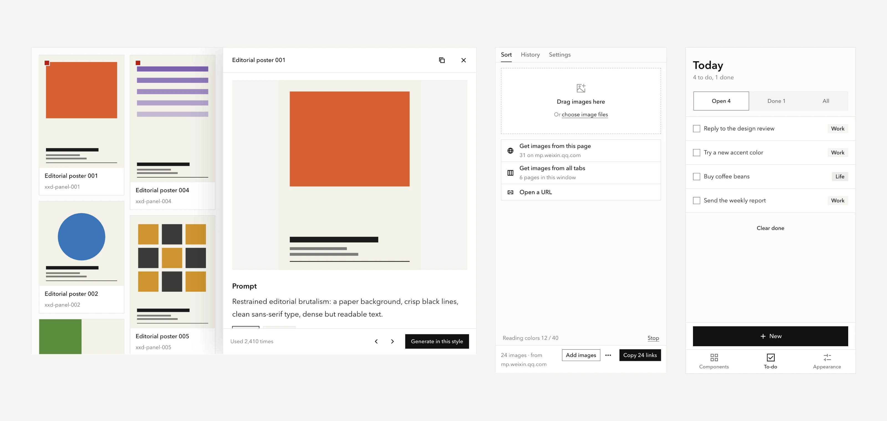
  </picture>
</a>

<sub>Not a mockup: a screenshot of pages on the showcase, built from the real components.</sub>

</div>

<br>

## Try it in 30 seconds

Nothing to install. Paste this into a new `.html` file and open it in a browser:

```html
<script src="https://ui.xiaoxiaodong.ai/v/0.1.0/boot.js" data-key="my-site-ui"></script>
<link rel="stylesheet" href="https://ui.xiaoxiaodong.ai/v/0.1.0/xxd.css" />
<script src="https://ui.xiaoxiaodong.ai/v/0.1.0/icons.js"></script>
<script src="https://ui.xiaoxiaodong.ai/v/0.1.0/xxd.js"></script>

<body class="xxd-page">
  <button class="xxd-btn" data-variant="primary">Save</button>
</body>
```

For any other component, open it on the [showcase](https://ui.xiaoxiaodong.ai/en/) and copy its HTML.

## What's in it

73 components, 18 common patterns (drop to upload, confirm twice, sign-in, buying a membership…), 7 whole-page templates and 500+ icons. A few of them below; click one to open its page on the showcase:

<table>
<tr>
  <td align="center" width="33%"><a href="https://ui.xiaoxiaodong.ai/en/components/button"><picture><source media="(prefers-color-scheme: dark)" srcset="docs/assets/readme/button-dark.en.webp">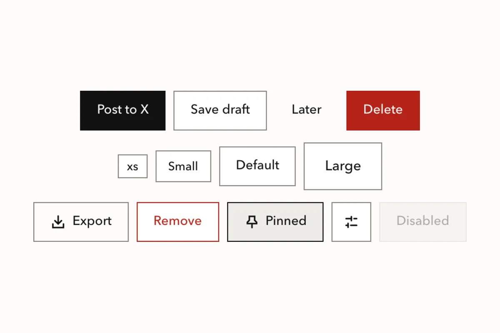</picture></a><br><b>Buttons</b><br><sub>One solid button per place; the label says what a click does</sub></td>
  <td align="center" width="33%"><a href="https://ui.xiaoxiaodong.ai/en/components/field"><picture><source media="(prefers-color-scheme: dark)" srcset="docs/assets/readme/field-dark.en.webp">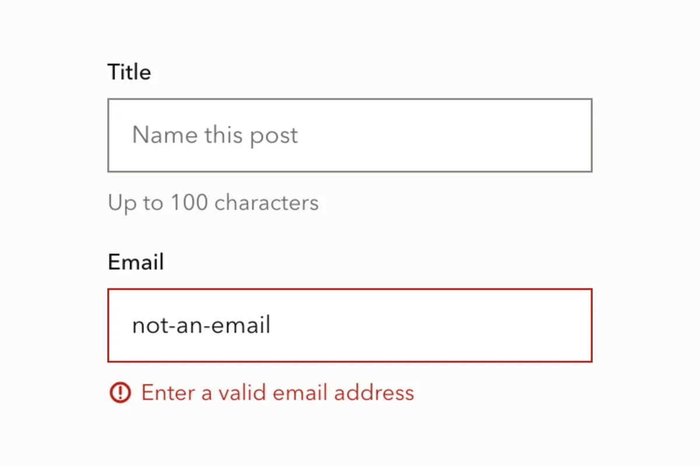</picture></a><br><b>Forms</b><br><sub>Errors go under the field, with an icon</sub></td>
  <td align="center" width="33%"><a href="https://ui.xiaoxiaodong.ai/en/components/settings-group"><picture><source media="(prefers-color-scheme: dark)" srcset="docs/assets/readme/settings-group-dark.en.webp">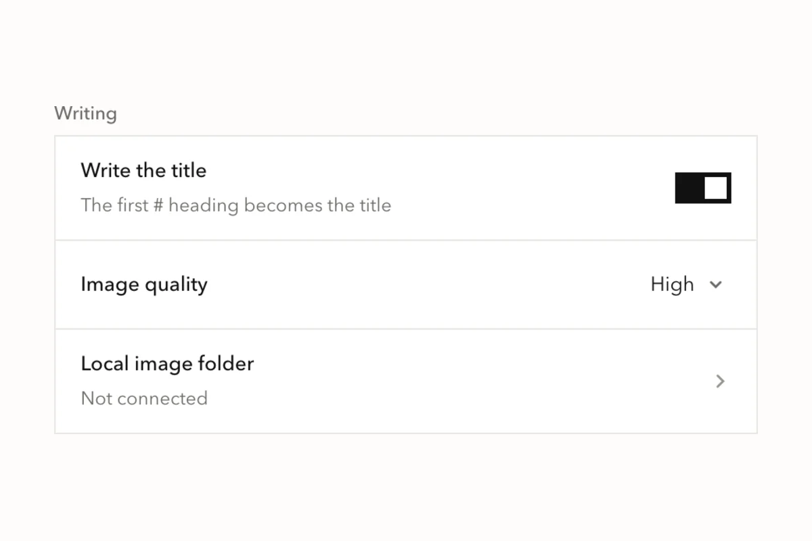</picture></a><br><b>Settings</b><br><sub>Switches, selects and links, one per row</sub></td>
</tr>
<tr>
  <td align="center"><a href="https://ui.xiaoxiaodong.ai/en/components/table"><picture><source media="(prefers-color-scheme: dark)" srcset="docs/assets/readme/table-dark.en.webp">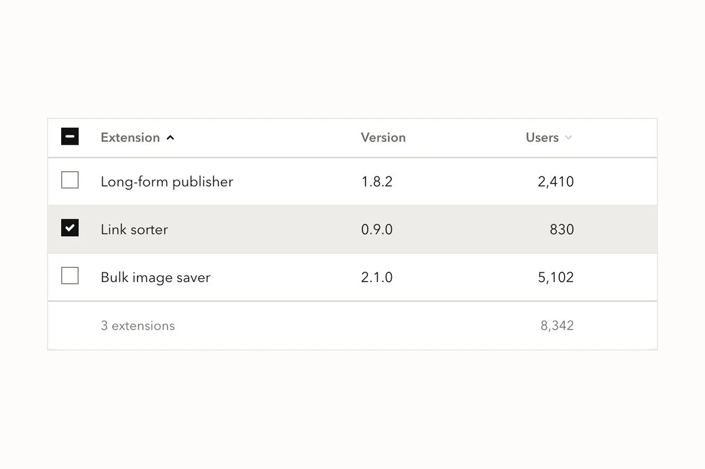</picture></a><br><b>Tables</b><br><sub>Sorting, selection, totals; numbers on the right</sub></td>
  <td align="center"><a href="https://ui.xiaoxiaodong.ai/en/components/dialog"><picture><source media="(prefers-color-scheme: dark)" srcset="docs/assets/readme/dialog-dark.en.webp">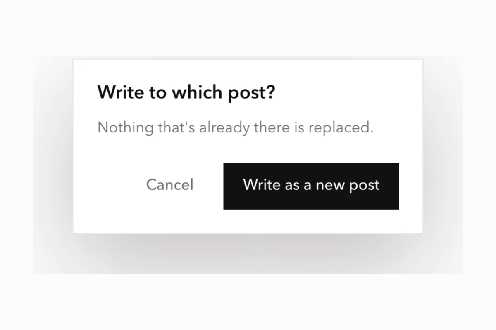</picture></a><br><b>Dialogs</b><br><sub>Cancel first, the action last on the right</sub></td>
  <td align="center"><a href="https://ui.xiaoxiaodong.ai/en/components/command-palette"><picture><source media="(prefers-color-scheme: dark)" srcset="docs/assets/readme/command-palette-dark.en.webp">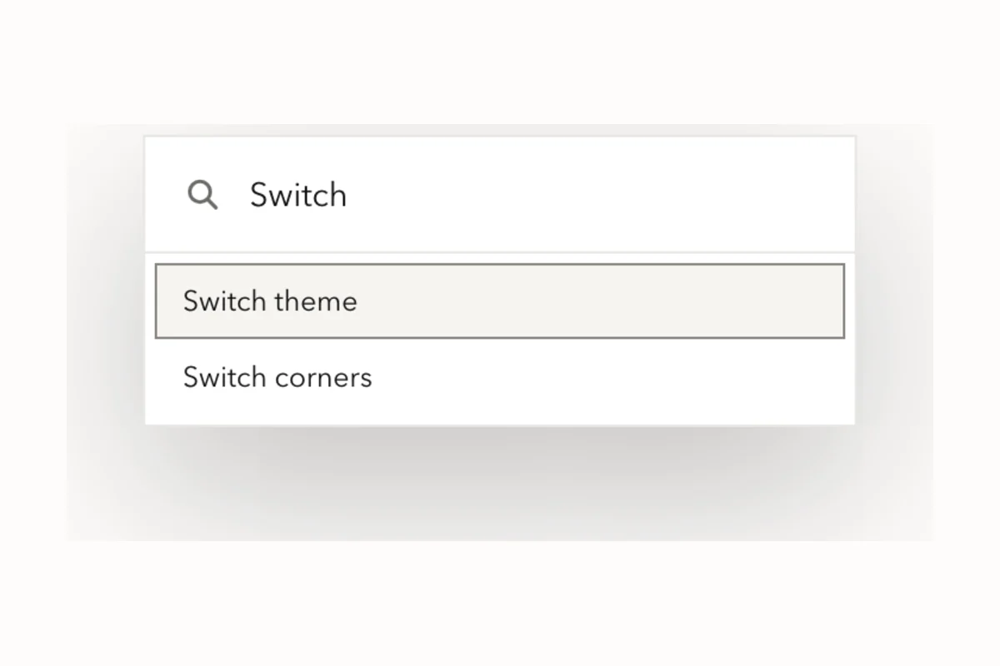</picture></a><br><b>Command palette</b><br><sub>⌘K to find any action</sub></td>
</tr>
<tr>
  <td align="center"><a href="https://ui.xiaoxiaodong.ai/en/components/chart"><picture><source media="(prefers-color-scheme: dark)" srcset="docs/assets/readme/chart-dark.en.webp">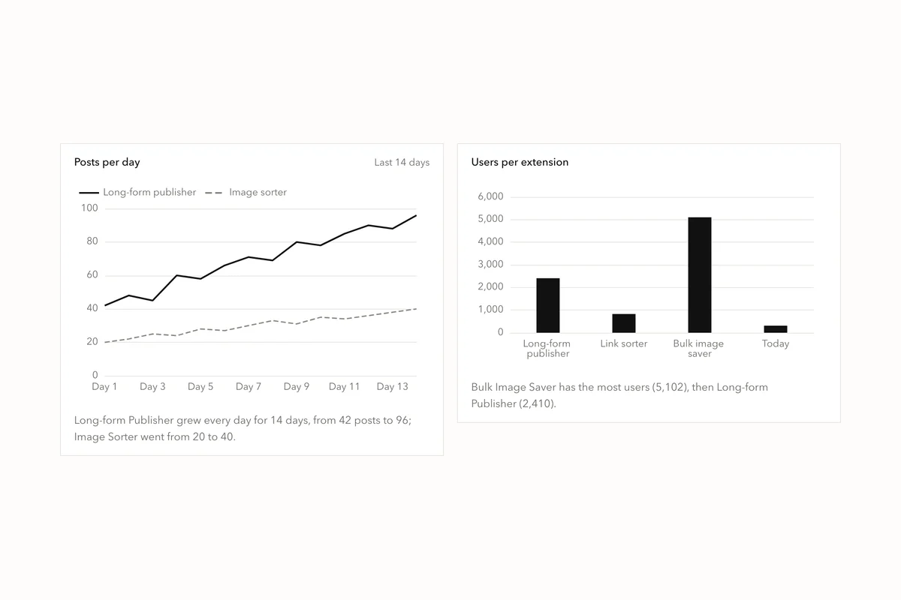</picture></a><br><b>Charts</b><br><sub>ECharts in the same colors</sub></td>
  <td align="center"><a href="https://ui.xiaoxiaodong.ai/en/components/gauge"><picture><source media="(prefers-color-scheme: dark)" srcset="docs/assets/readme/gauge-dark.en.webp">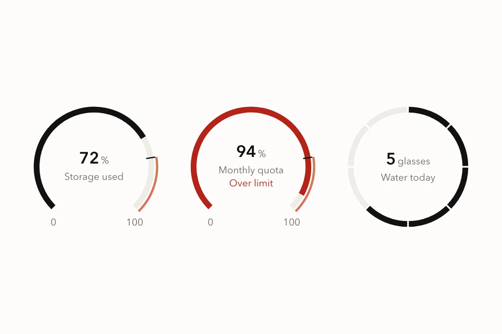</picture></a><br><b>Gauges</b><br><sub>How much is used; red when over</sub></td>
  <td align="center"><a href="https://ui.xiaoxiaodong.ai/en/components/heatmap"><picture><source media="(prefers-color-scheme: dark)" srcset="docs/assets/readme/heatmap-dark.en.webp">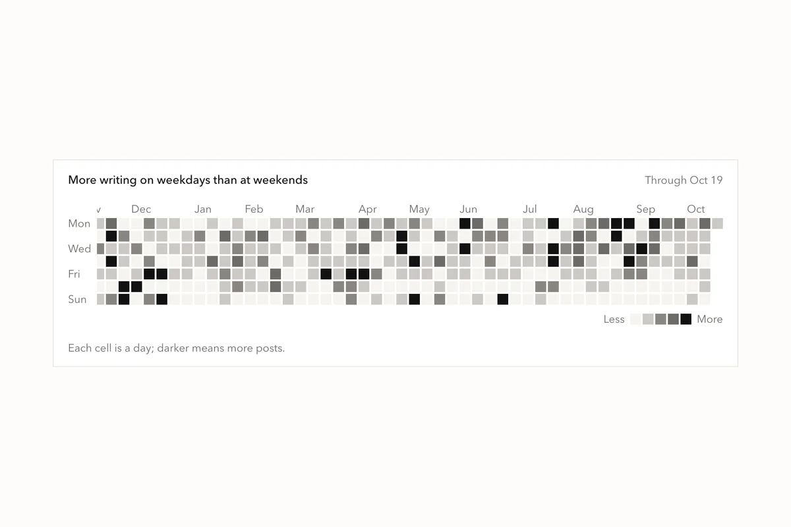</picture></a><br><b>Heatmap</b><br><sub>How much on each day of a year</sub></td>
</tr>
<tr>
  <td align="center"><a href="https://ui.xiaoxiaodong.ai/en/components/steps"><picture><source media="(prefers-color-scheme: dark)" srcset="docs/assets/readme/steps-dark.en.webp">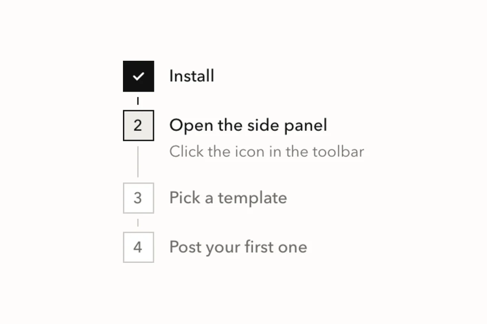</picture></a><br><b>Steps</b><br><sub>Which step you're on</sub></td>
  <td align="center"><a href="https://ui.xiaoxiaodong.ai/en/components/flowchart"><picture><source media="(prefers-color-scheme: dark)" srcset="docs/assets/readme/flowchart-dark.en.webp">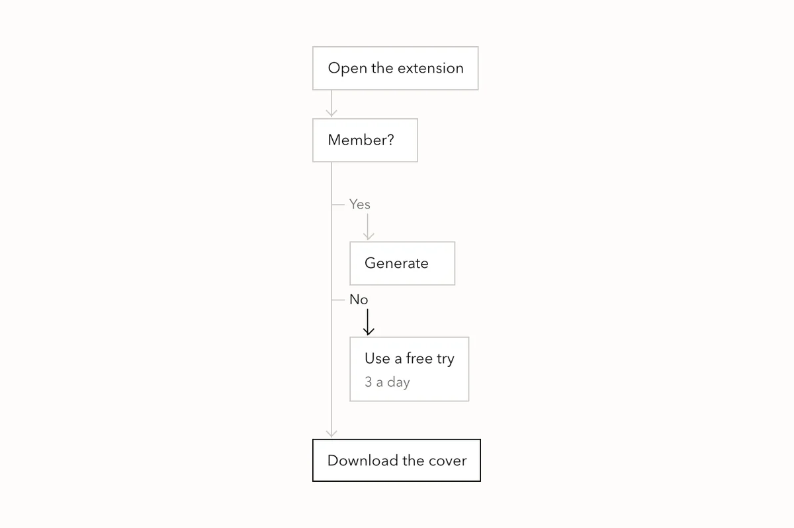</picture></a><br><b>Flowchart</b><br><sub>A process with a decision, in plain HTML and CSS</sub></td>
  <td align="center"><a href="https://ui.xiaoxiaodong.ai/en/components/timeline"><picture><source media="(prefers-color-scheme: dark)" srcset="docs/assets/readme/timeline-dark.en.webp">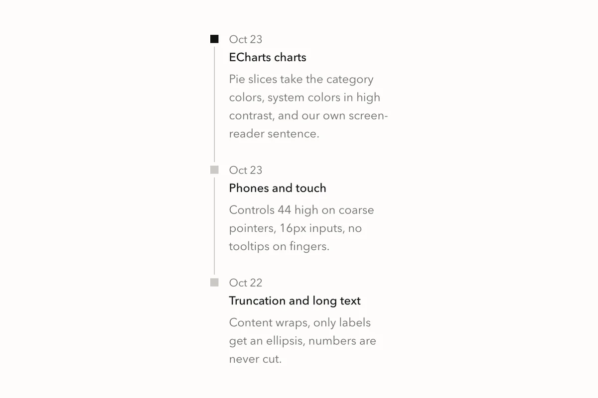</picture></a><br><b>Timeline</b><br><sub>Release notes, an order's history</sub></td>
</tr>
</table>

### A different accent, rounded corners: still the same kit

Only a few things change: light or dark, square or rounded, the accent color, and density. The same extension side panel four ways:

<p align="center">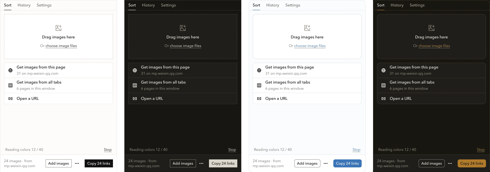</p>

## Why it exists

XXD (小小东) makes more than a dozen Chrome extensions and websites. This kit was made for them, so that things made by the same person look like they belong together. 14 projects use it today, and when a component changes, one command syncs it to all of them.

So it takes particular care of:

- **Chrome extensions**: one command sets up a side panel, a settings page and a popup, in Simplified Chinese, Traditional Chinese and English. Extension pages can't run inline scripts; the components don't need any, and `xxd-ui doctor` catches them if you write one.
- **No framework**: plain pages and extension pages just link the CSS and JS. There's also a React version and a WeChat mini program version (50 components) that look the same.
- **Chinese text**: Chinese is never smaller than 12px; long text wraps, and only labels that don't fit are cut short, with the full text on hover; pressing Enter while an input method is composing doesn't submit the form.

Every change runs more than 1,900 unit tests, plus 22 checks in a real browser: contrast, dark mode, whether targets are big enough to tap on a phone, whether long text breaks the layout, and whether screen readers can read it.

## How it compares

| | [Ant Design](https://ant.design) | [shadcn/ui](https://ui.shadcn.com) | XXD UI Kit |
| --- | --- | --- | --- |
| How you use it | Install React components from npm | Copy component source into your project | Link one CSS and one JS file; React and mini program versions too |
| Good for | Big admin apps, complex forms | Editing every component yourself | Chrome extensions, small sites, tool pages |
| Look | Its own, deeply customizable | A starting point, change it to anything | This one look; change the accent, corners and density |
| Framework | React | React + Tailwind | None |
| License | MIT, commercial use is free | MIT, commercial use is free | Free for noncommercial use; commercial use needs a paid license |

The downsides, plainly:

- Early days (0.x). Not on npm yet, and versions may break things (see the [changelog](CHANGELOG.en.md)).
- There is one style. If you want a completely different look, this isn't it.
- For big admin apps and complex tables and forms, use Ant Design.
- Commercial use needs a paid license (see [License](#license) below).

## Install

You need Node 24.12+ and pnpm. Install once:

```bash
git clone https://github.com/nevertoday/xxd-ui-kit.git
cd xxd-ui-kit
pnpm install
pnpm xxd:build   # takes a few minutes the first time
pnpm xxd link    # installs the xxd-ui command so it works from any folder
```

Then pick what you're doing:

<details>
<summary><b>Make a new Chrome extension</b></summary>

```bash
xxd-ui new ./today --name 今日待办 --name-en Today --slug today
```

Open `chrome://extensions`, turn on Developer mode, click "Load unpacked" and pick the `today` folder.

Add more with flags: `--popup` for the small window behind the toolbar icon, `--content "https://example.com/*"` to put UI on web pages, `--account` for sign-in and membership pages. More in the [extension kit](docs/en/EXTENSION-KIT.md).

</details>

<details>
<summary><b>Add it to an existing page or extension</b></summary>

```bash
xxd-ui init ./my-site
```

It copies the component files into `my-site` and tells you which lines to add to `<head>`.

Your site already has its own colors and shouldn't change: see [existing sites](docs/en/existing-site.md). Using a bundler like Vite: see [Get started](https://ui.xiaoxiaodong.ai/en/start).

</details>

<details>
<summary><b>Use it in React</b></summary>

```bash
xxd-ui pack ./packs          # in xxd-ui-kit: build the packages
npm install ./packs/*.tgz    # in your project
```

```tsx
import { Button } from "@xxd/react";
import "@xxd/react/standalone.css";
```

Tailwind, appearance and language settings: see [Get started](https://ui.xiaoxiaodong.ai/en/start).

</details>

<details>
<summary><b>Make a WeChat mini program</b></summary>

```bash
xxd-ui new-mini ./today-mini --name "Today" --slug today-mini
cd ./today-mini && pnpm install && pnpm dev:weapp
```

Open WeChat DevTools and import the `today-mini` folder. It's Taro 4.2 + React. More on the [mini program kit](https://ui.xiaoxiaodong.ai/en/miniprogram) page.

</details>

<details>
<summary><b>Updates, finding components and icons</b></summary>

```bash
xxd-ui status          # which projects are on an old version
xxd-ui sync --all      # update them all
xxd-ui doctor ./today  # check for typos, hard-coded colors and extension config problems
xxd-ui doc dialog      # how to write one component (English or Chinese name)
xxd-ui icon delete     # find an icon
xxd-ui help            # every command
```

</details>

## The look, in one paragraph

Square corners by default; only radio buttons and loading spinners are round. Black, white and gray plus one accent color, with emphasis carried by ink rather than color. No shadows on cards or buttons. A line's color says what it's for: light for containers, darker for structure, red for errors. Only the system's own sans-serif fonts, in three weights. Animation only changes opacity and position. The reason for each rule is in the [design principles](https://ui.xiaoxiaodong.ai/en/principles).

For designers: you can design with it without opening the code; start at [For designers](https://ui.xiaoxiaodong.ai/en/designers). Common component pages have a Spec section with sizes, spacing and type measured from the real CSS. There is no Figma library; the showcase is the source.

## Contributing

Issues and improvements are welcome. Start with [CONTRIBUTING](CONTRIBUTING.en.md): what's welcome, where to change things, how to run the tests. Found a security problem? Report it privately as described in [SECURITY.md](SECURITY.md).

## Kumo

The React components come from Cloudflare's open-source component library [Kumo](https://github.com/cloudflare/kumo) (MIT), restyled; everything else is this project's own. The original Kumo code stays under MIT (see [LICENSE-KUMO](LICENSE-KUMO)). This project is not affiliated with or endorsed by Cloudflare.

## License

The source is public. **Noncommercial use is free; commercial use needs a paid license from XXD first.**

- License: [PolyForm Noncommercial 1.0.0](LICENSE).
- What counts as commercial and how to get a license: see [Licensing and commercial use](COMMERCIAL.en.md), or the [commercial license](https://ui.xiaoxiaodong.ai/en/license) page on the showcase.
- Versions released under MIT up to and including 2026-11-01: if you already have one, you can keep using it under MIT.

<div align="center"><br>

Made by **[XXD](https://ui.xiaoxiaodong.ai/en/)**. If it's useful, give it a star.

</div>
