<div align="center">

# 小小东 UI Kit

**安静、克制的界面组件：直角、黑白灰、细线、系统字体。<br>一个 CSS 加一个 JS 就能用，Chrome 插件、网页、React、微信小程序是同一个样子。**

[](https://github.com/nevertoday/xxd-ui-kit/actions/workflows/xxd.yml) [](LICENSE)  

**[展示站](https://ui.xiaoxiaodong.ai) · [开始使用](https://ui.xiaoxiaodong.ai/start) · [设计原则](docs/DESIGN-PRINCIPLES.md) · [更新记录](CHANGELOG.md)**

**中文** · [English](README.en.md)

<br>

<a href="https://ui.xiaoxiaodong.ai">
  <picture>
    <source media="(prefers-color-scheme: dark)" srcset="docs/assets/readme/hero-dark.webp">
    
  </picture>
</a>

<sub>上图不是设计稿，是展示站上用真组件拼的页面截图。</sub>

</div>

<br>

## 30 秒试一下

不用装任何东西。新建一个 `.html` 文件，贴进去，用浏览器打开：

```html
<script src="https://ui.xiaoxiaodong.ai/v/0.1.0/boot.js" data-key="my-site-ui"></script>
<link rel="stylesheet" href="https://ui.xiaoxiaodong.ai/v/0.1.0/xxd.css" />
<script src="https://ui.xiaoxiaodong.ai/v/0.1.0/icons.js"></script>
<script src="https://ui.xiaoxiaodong.ai/v/0.1.0/xxd.js"></script>

<body class="xxd-page">
  <button class="xxd-btn" data-variant="primary">保存</button>
</body>
```

想要别的组件，到[展示站](https://ui.xiaoxiaodong.ai)点开，复制那段 HTML 就行。

## 里面有什么

73 个组件、18 个常用模式（拖放上传、两次确认、登录、会员购买……）、7 个整页模板、500 多个图标。下面是其中一部分，点图打开它在展示站上的页面：

<table>
<tr>
  <td align="center" width="33%"><a href="https://ui.xiaoxiaodong.ai/components/button"><picture><source media="(prefers-color-scheme: dark)" srcset="docs/assets/readme/button-dark.webp">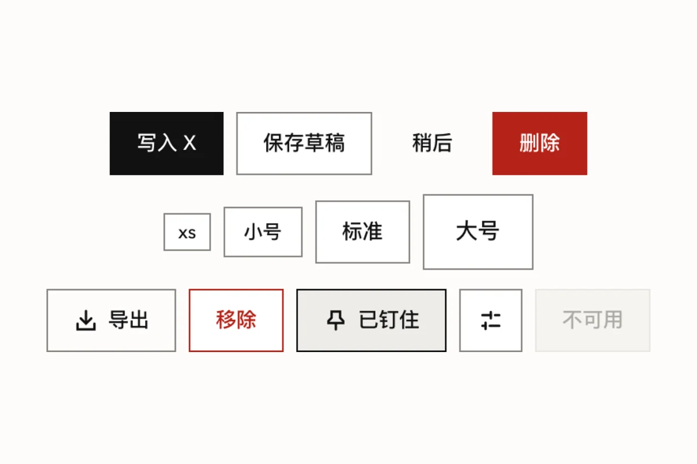</picture></a><br><b>按钮</b><br><sub>一处只放一个实心按钮，文字写清点了做什么</sub></td>
  <td align="center" width="33%"><a href="https://ui.xiaoxiaodong.ai/components/field"><picture><source media="(prefers-color-scheme: dark)" srcset="docs/assets/readme/field-dark.webp">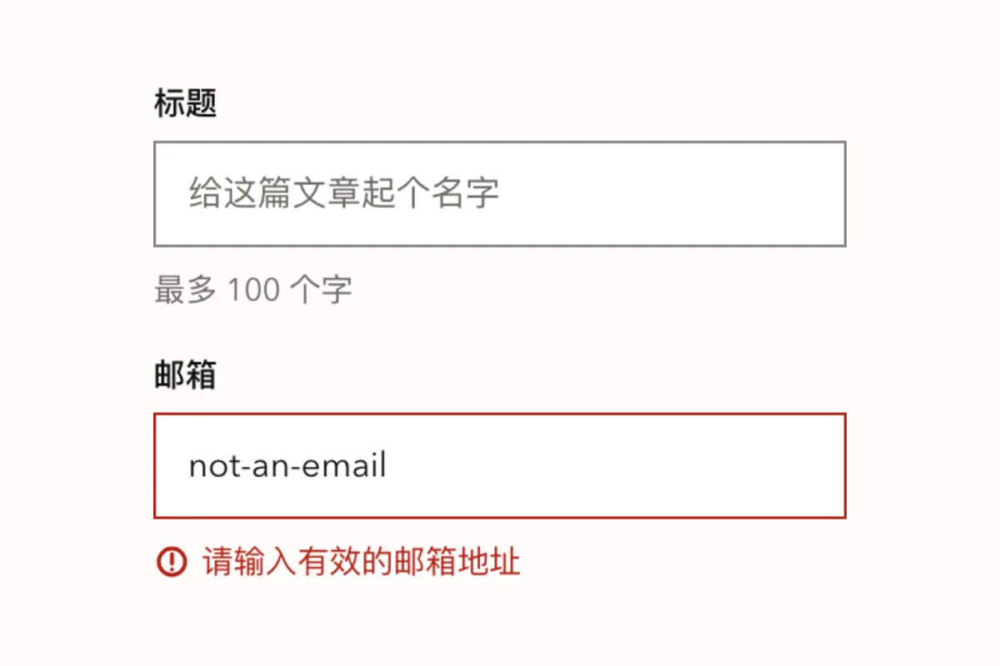</picture></a><br><b>表单</b><br><sub>出错的话写在输入框下面，前面一个图标</sub></td>
  <td align="center" width="33%"><a href="https://ui.xiaoxiaodong.ai/components/settings-group"><picture><source media="(prefers-color-scheme: dark)" srcset="docs/assets/readme/settings-group-dark.webp">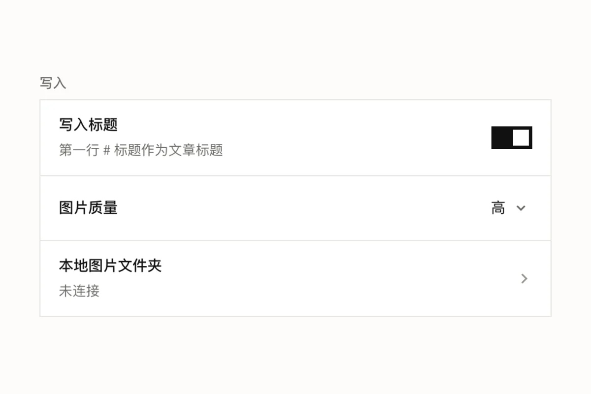</picture></a><br><b>设置页</b><br><sub>开关、选择、跳转，一行一项</sub></td>
</tr>
<tr>
  <td align="center"><a href="https://ui.xiaoxiaodong.ai/components/table"><picture><source media="(prefers-color-scheme: dark)" srcset="docs/assets/readme/table-dark.webp">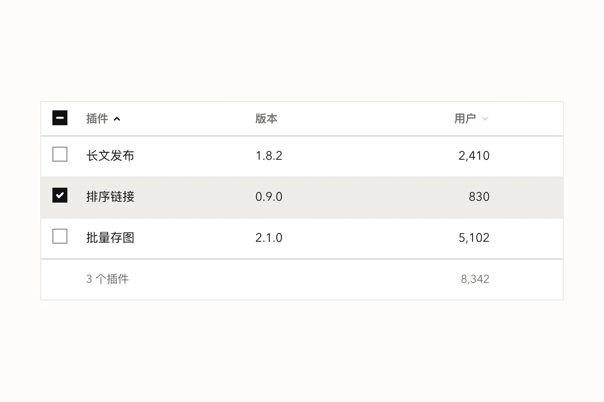</picture></a><br><b>表格</b><br><sub>排序、勾选、合计，数字靠右</sub></td>
  <td align="center"><a href="https://ui.xiaoxiaodong.ai/components/dialog"><picture><source media="(prefers-color-scheme: dark)" srcset="docs/assets/readme/dialog-dark.webp">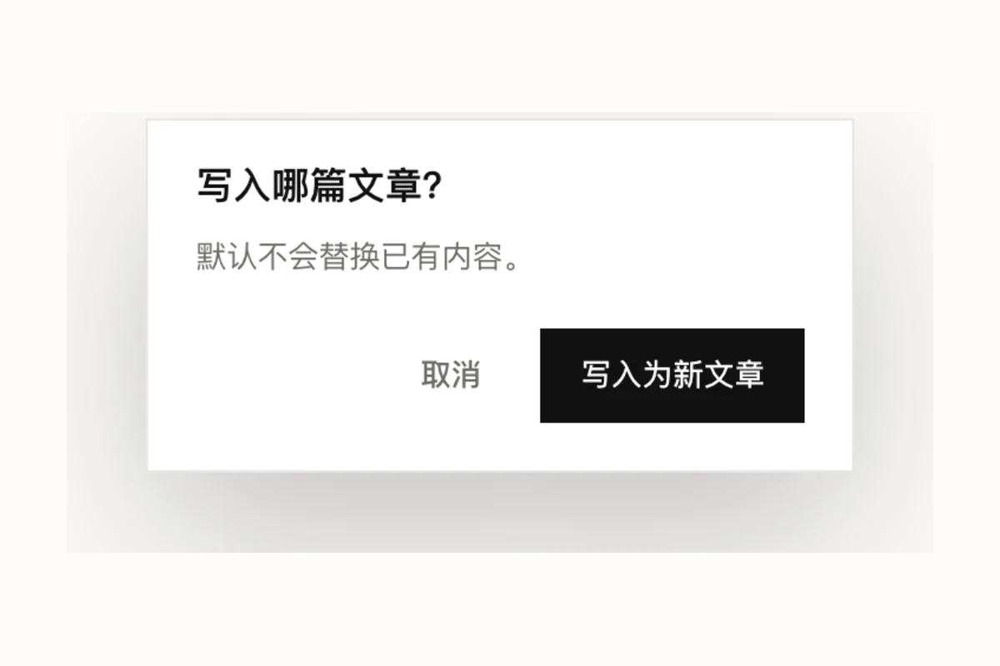</picture></a><br><b>对话框</b><br><sub>取消在左，要做的事在最右</sub></td>
  <td align="center"><a href="https://ui.xiaoxiaodong.ai/components/command-palette"><picture><source media="(prefers-color-scheme: dark)" srcset="docs/assets/readme/command-palette-dark.webp">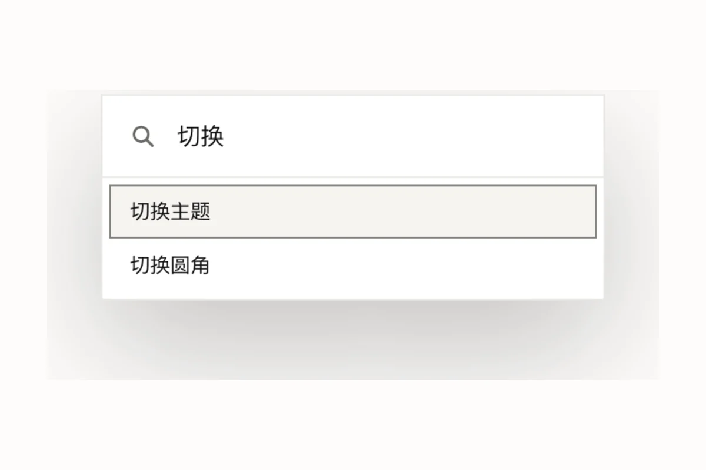</picture></a><br><b>命令面板</b><br><sub>⌘K 搜功能</sub></td>
</tr>
<tr>
  <td align="center"><a href="https://ui.xiaoxiaodong.ai/components/chart"><picture><source media="(prefers-color-scheme: dark)" srcset="docs/assets/readme/chart-dark.webp">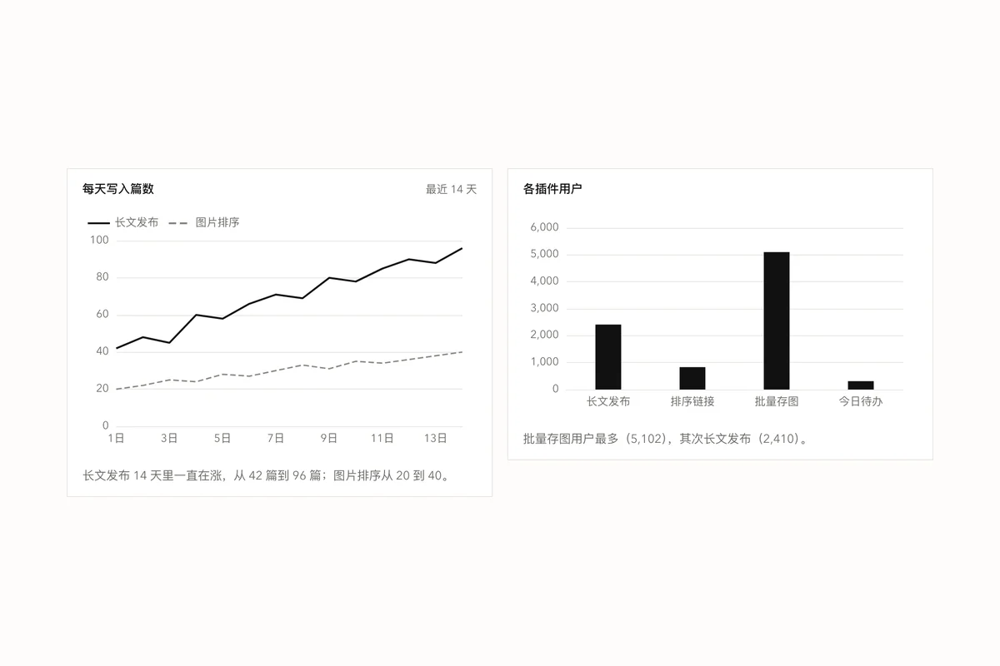</picture></a><br><b>图表</b><br><sub>ECharts 套上同一套颜色</sub></td>
  <td align="center"><a href="https://ui.xiaoxiaodong.ai/components/gauge"><picture><source media="(prefers-color-scheme: dark)" srcset="docs/assets/readme/gauge-dark.webp">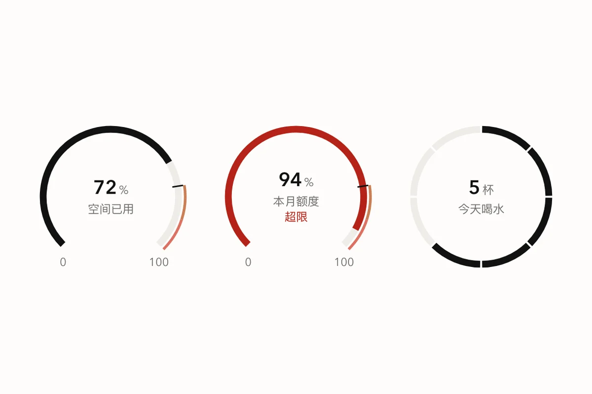</picture></a><br><b>量表</b><br><sub>用了多少、还剩多少，超了变红</sub></td>
  <td align="center"><a href="https://ui.xiaoxiaodong.ai/components/heatmap"><picture><source media="(prefers-color-scheme: dark)" srcset="docs/assets/readme/heatmap-dark.webp">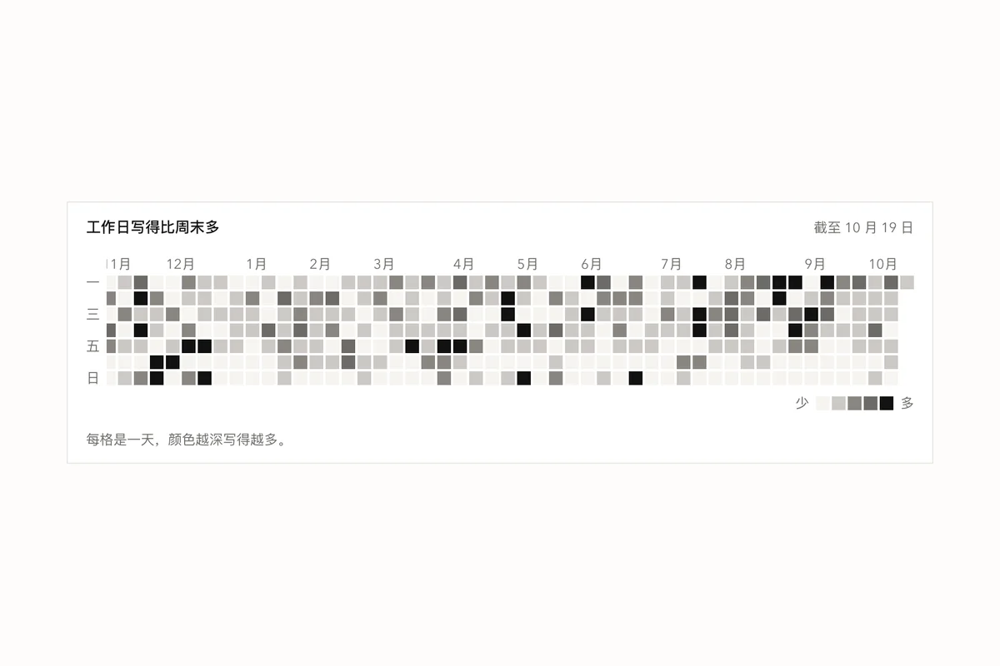</picture></a><br><b>热力格</b><br><sub>一年里每天做了多少</sub></td>
</tr>
<tr>
  <td align="center"><a href="https://ui.xiaoxiaodong.ai/components/steps"><picture><source media="(prefers-color-scheme: dark)" srcset="docs/assets/readme/steps-dark.webp">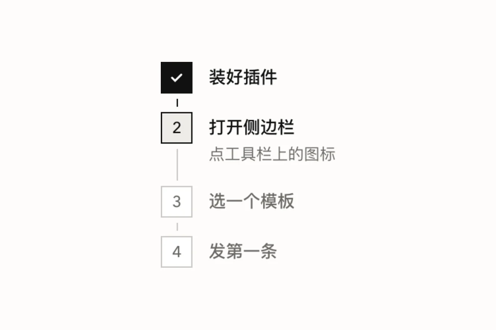</picture></a><br><b>步骤</b><br><sub>做到第几步了</sub></td>
  <td align="center"><a href="https://ui.xiaoxiaodong.ai/components/flowchart"><picture><source media="(prefers-color-scheme: dark)" srcset="docs/assets/readme/flowchart-dark.webp">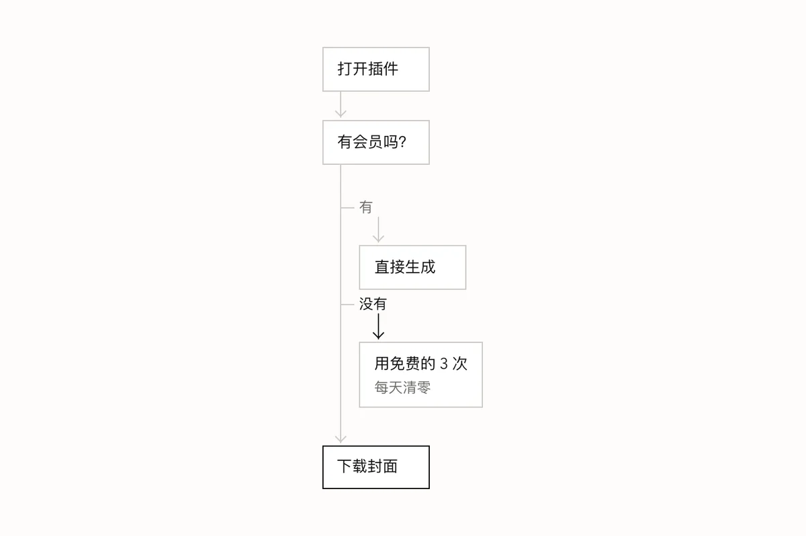</picture></a><br><b>流程图</b><br><sub>有判断的过程，纯 HTML 和 CSS</sub></td>
  <td align="center"><a href="https://ui.xiaoxiaodong.ai/components/timeline"><picture><source media="(prefers-color-scheme: dark)" srcset="docs/assets/readme/timeline-dark.webp">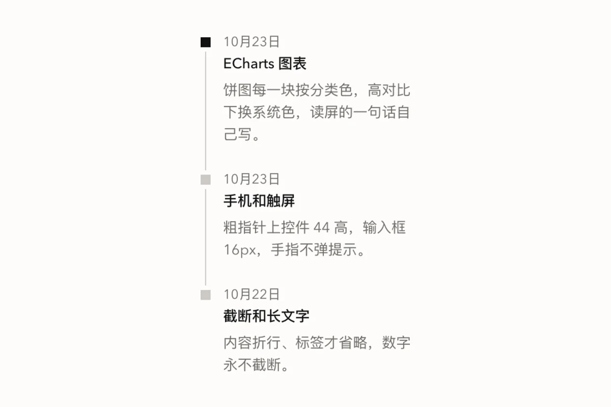</picture></a><br><b>时间线</b><br><sub>更新记录、订单经过</sub></td>
</tr>
</table>

### 换个主色、换成圆角，还是它

样子能调的只有几样：亮 / 暗、直角 / 圆角、主色、疏密。下面是同一个插件侧边栏的四种调法：

<p align="center"></p>

## 为什么做它

小小东做了十几个 Chrome 插件和网站。这套组件就是给它们做的：同一个人做的东西，应该一眼看出是一家的。现在 14 个项目都在用，组件改了，一条命令同步过去。

所以它特别照顾这些事：

- **Chrome 插件**：一条命令建好侧边栏、设置页、弹出小窗，中文、繁体、英文都有。插件页面不许写内联脚本，组件本身用不着，`xxd-ui doctor` 也会帮你查出来。
- **不要框架**：普通网页、插件页面直接引 CSS 和 JS。要 React 也有，要微信小程序也有（50 个组件），样子一样。
- **中文**：中文字号不小于 12px；长文字会折行，放不下的标签才省略、悬停能看全；输入法拼字时按回车不会提交表单。

每次改动，除了 1900 多个单元测试，还会在真浏览器里跑 22 项检查：对比度够不够、暗色对不对、手机上点不点得到、长文字会不会撑破、读屏软件读得出来吗。

## 和别的组件库比

| | [Ant Design](https://ant.design) | [shadcn/ui](https://ui.shadcn.com) | 小小东 UI Kit |
| --- | --- | --- | --- |
| 怎么用 | npm 装 React 组件 | 把组件源码拷进项目 | 引一个 CSS 和一个 JS；也有 React 和小程序版 |
| 适合 | 大型后台、复杂表单 | 想自己改每个组件 | Chrome 插件、小网站、工具页 |
| 样子 | 自己的一套，可以深度定制 | 起点，改成什么都行 | 只有这一种，能换主色、圆角、疏密 |
| 框架 | React | React + Tailwind | 不要框架 |

短处也说清楚：

- 还在早期（0.x），没发布到 npm，版本之间可能有不兼容的改动（见[更新记录](CHANGELOG.md)）。
- 风格只有一种。想要完全不同的样子，它不合适。
- 大型后台、复杂的表格和表单，还是用 Ant Design。

## 装起来

需要 Node 24.12 以上和 pnpm。装一次：

```bash
git clone https://github.com/nevertoday/xxd-ui-kit.git
cd xxd-ui-kit
pnpm install
pnpm xxd:build   # 第一次要几分钟
pnpm xxd link    # 装好命令 xxd-ui，之后在哪个目录都能用
```

然后看你要做什么：

<details>
<summary><b>做一个新的 Chrome 插件</b></summary>

```bash
xxd-ui new ./today --name 今日待办 --name-en Today --slug today
```

打开 `chrome://extensions`，开「开发者模式」，点「加载已解压的扩展程序」，选 `today` 文件夹。

要更多就加参数：`--popup` 加点图标弹出的小窗，`--content "https://example.com/*"` 往网页里放界面，`--account` 加登录和会员页。详细见[插件套件](docs/EXTENSION-KIT.md)。

</details>

<details>
<summary><b>给已有的网页或插件用</b></summary>

```bash
xxd-ui init ./my-site
```

它把组件文件拷进 `my-site`，再告诉你往 `<head>` 里加哪几行。

网站已经有自己的颜色、不想变样子：看[已有网站怎么接入](docs/existing-site.md)。用 Vite 这类打包工具：看[开始使用](https://ui.xiaoxiaodong.ai/start)。

</details>

<details>
<summary><b>在 React 里用</b></summary>

```bash
xxd-ui pack ./packs          # 在 xxd-ui-kit 里打包
npm install ./packs/*.tgz    # 在你的项目里安装
```

```tsx
import { Button } from "@xxd/react";
import "@xxd/react/standalone.css";
```

用 Tailwind、要加外观和语言设置：看[开始使用](https://ui.xiaoxiaodong.ai/start)。

</details>

<details>
<summary><b>做一个微信小程序</b></summary>

```bash
xxd-ui new-mini ./today-mini --name 今日待办 --slug today-mini
cd ./today-mini && pnpm install && pnpm dev:weapp
```

打开微信开发者工具，「导入项目」选 `today-mini` 文件夹。基于 Taro 4.2 + React。详细见[小程序版](https://ui.xiaoxiaodong.ai/miniprogram)。

</details>

<details>
<summary><b>组件更新了、找组件、找图标</b></summary>

```bash
xxd-ui status          # 哪些项目用的是旧版
xxd-ui sync --all      # 全部更新
xxd-ui doctor ./today  # 检查写错的地方、写死的颜色、插件配置
xxd-ui doc 对话框      # 一个组件怎么写（中文名、英文名都行）
xxd-ui icon 删除       # 找图标，可以用中文搜
xxd-ui help            # 全部命令
```

</details>

## 样子的规矩（一段话说完）

默认直角，只有单选框和加载转圈是圆的。颜色只有黑白灰，再加一个主色，强调靠墨色，不靠彩色。卡片、按钮不加阴影。线的颜色看用途：外框浅，结构线深，出错是红的。字只用系统自带的无衬线字体，粗细只有三档。动画只改透明度和位置。为什么这样定，每一条都写在[设计原则](docs/DESIGN-PRINCIPLES.md)里。

给设计师：不打开代码也能用它出稿，从[设计师从这里开始](https://ui.xiaoxiaodong.ai/designers)看起。常用组件页有「规格」，尺寸、间距、字号都是从真的 CSS 量出来的。没有 Figma 库，展示站就是来源。

## 参与

欢迎提问题、提改进。先看[参与指南](CONTRIBUTING.md)：欢迎什么、改哪里、怎么跑测试。发现安全问题，请按 [SECURITY.md](SECURITY.md) 私下告诉我们。

## 和 Kumo 的关系

React 组件来自 Cloudflare 的开源组件库 [Kumo](https://github.com/cloudflare/kumo)（MIT），换上了小小东的样子；其他部分是这个项目自己写的。本项目和 Cloudflare 没有关系，也没有得到它的认可。

## 许可

MIT，见 [LICENSE](LICENSE)；来自 Kumo 的代码见 [LICENSE-KUMO](LICENSE-KUMO)。

<div align="center"><br>

**[小小东](https://ui.xiaoxiaodong.ai)** 做的。觉得有用，点个 Star。

</div>
