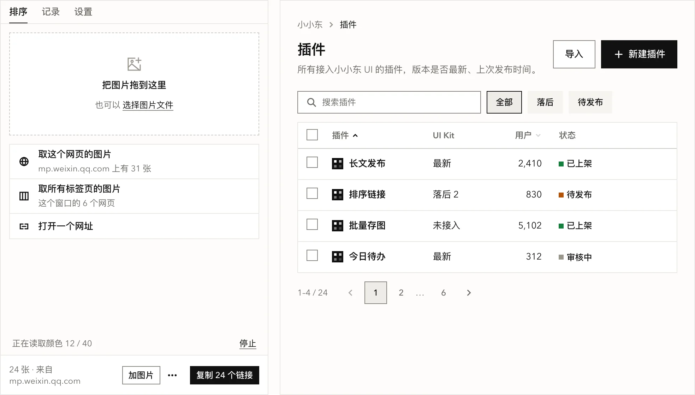
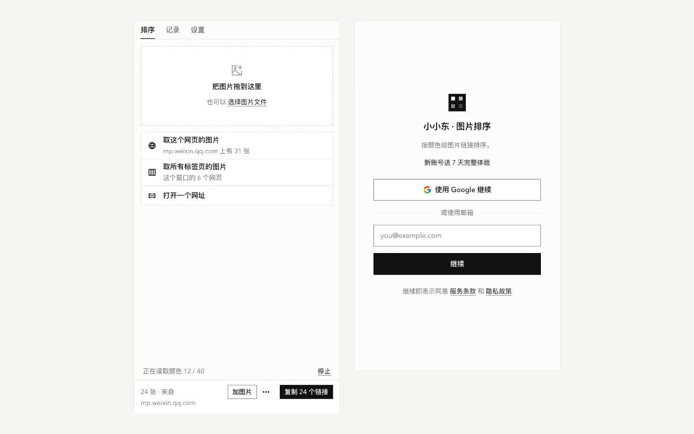
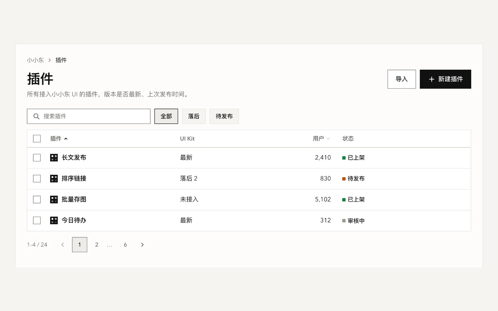
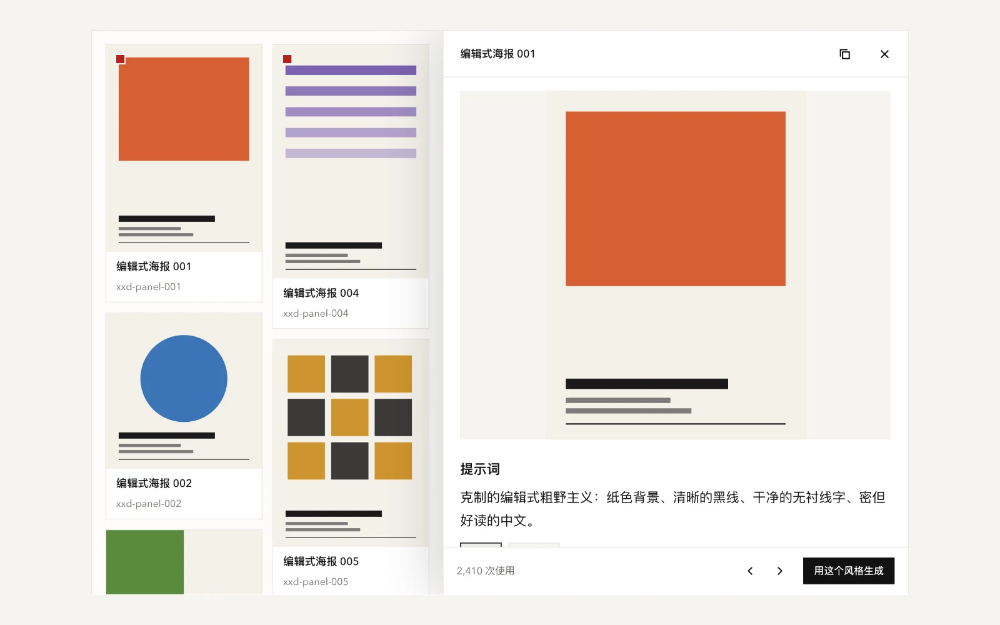
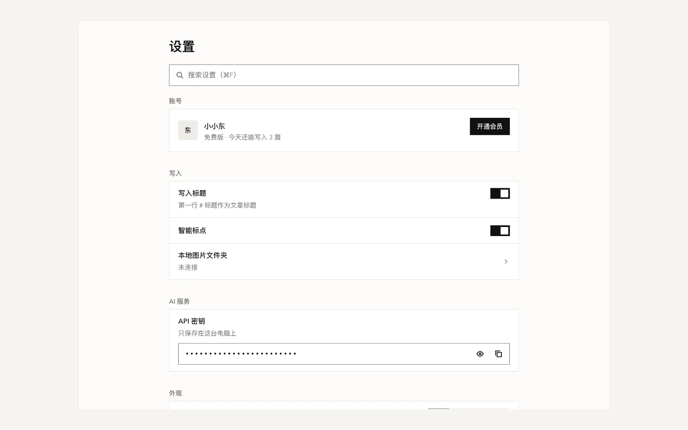
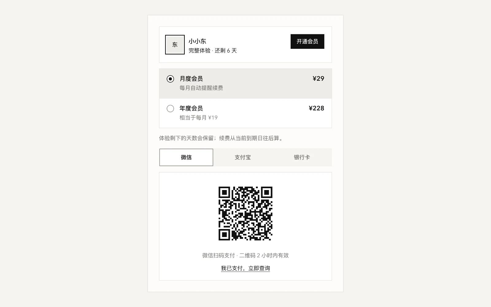
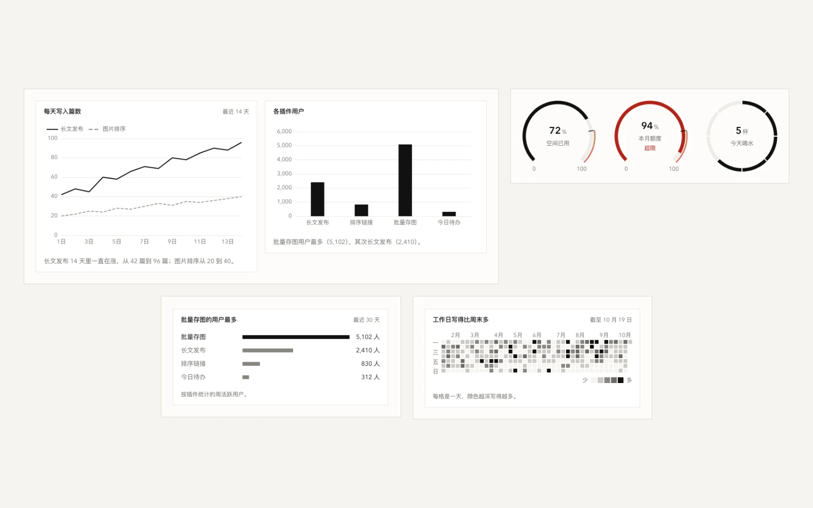
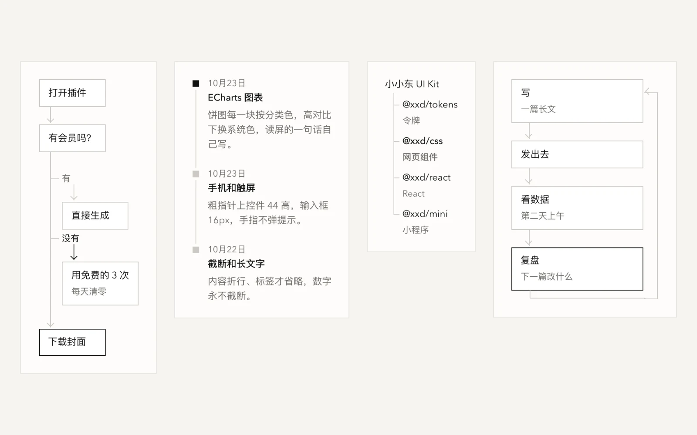
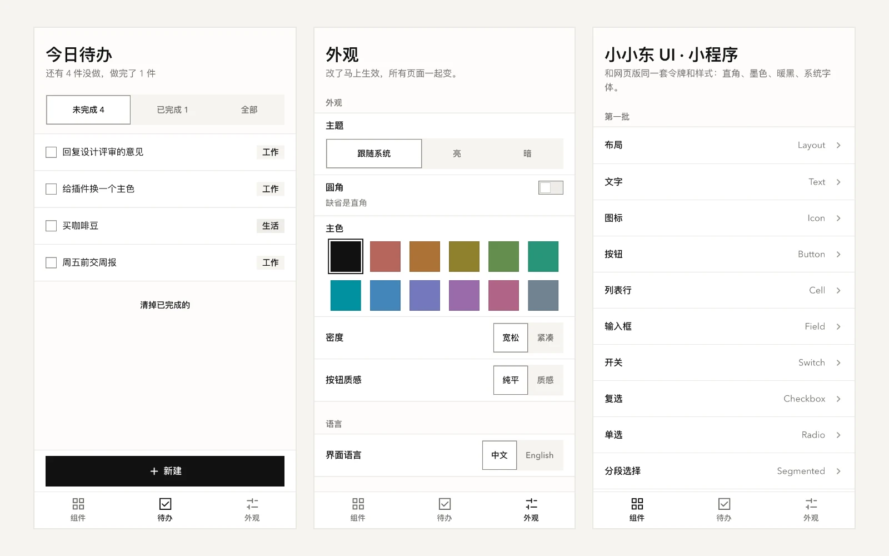
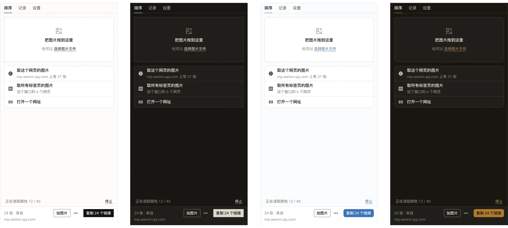

<div align="center">

# 小小东 UI Kit

**拿它做浏览器插件、网站、后台、微信小程序。<br>做出来的东西精致、好用，而且一看就是一家人。**

[](https://github.com/nevertoday/xxd-ui-kit/actions/workflows/xxd.yml) [](COMMERCIAL.md)   

**[看展示站](https://ui.xiaoxiaodong.ai) · [开始使用](https://ui.xiaoxiaodong.ai/start) · [设计原则](docs/DESIGN-PRINCIPLES.md) · [更新记录](CHANGELOG.md) · [商用授权](COMMERCIAL.md)**

**中文** · [English](README.en.md)

<br>

<a href="https://ui.xiaoxiaodong.ai">
  <picture>
    <source media="(prefers-color-scheme: dark)" srcset="docs/assets/readme/hero-dark.webp">
    
  </picture>
</a>

<sub>左边是网站，中间是 Chrome 插件，右边是微信小程序。三块都是真组件拼的，不是设计稿。</sub>

</div>

<br>

## 它替你省掉什么

做一个小产品，最磨人的常常是界面。按钮多高、灰字多灰、暗色怎么配、手机上点不点得准、出错的话写在哪，每个新项目都要重新想一遍，做完了几个项目还长得各不一样。

这套组件把这些都提前定好了，你只管拼页面：

- **贴几行就能用。** 普通网页引一个 CSS、一个 JS，不用装 Node，也不用打包。
- **一个样子，哪里都能用。** 网页、Chrome 插件、React、微信小程序长得一样，换主色、换圆角也一起换。
- **AI 写出来也是这个样子。** 自带给 AI 编程工具看的说明，Claude Code、Cursor 这类工具照着写，不会乱配颜色。

小小东自己的 14 个插件和网站都在用它。组件改了，一条命令同步到所有项目。

## 能做出什么

下面每张图都是展示站上的真页面，点图可以打开它，复制那段代码直接用。

<table>
<tr>
  <td width="50%"><a href="https://ui.xiaoxiaodong.ai/templates/extension-sidepanel"><picture><source media="(prefers-color-scheme: dark)" srcset="docs/assets/readme/use-extension-dark.webp"></picture></a><br><b>浏览器插件</b><br><sub>侧边栏、弹出小窗、设置页、登录页，一条命令建好。</sub></td>
  <td width="50%"><a href="https://ui.xiaoxiaodong.ai/templates/resource-list"><picture><source media="(prefers-color-scheme: dark)" srcset="docs/assets/readme/use-admin-dark.webp"></picture></a><br><b>后台和管理页</b><br><sub>搜索、筛选、排序、全选、分页。数字靠右，状态一眼看清。</sub></td>
</tr>
<tr>
  <td><a href="https://ui.xiaoxiaodong.ai/templates/detail-panel"><picture><source media="(prefers-color-scheme: dark)" srcset="docs/assets/readme/use-content-dark.webp"></picture></a><br><b>图片站和内容站</b><br><sub>瀑布流加详情面板。界面退到后面，内容自己说话。</sub></td>
  <td><a href="https://ui.xiaoxiaodong.ai/templates/settings"><picture><source media="(prefers-color-scheme: dark)" srcset="docs/assets/readme/use-settings-dark.webp"></picture></a><br><b>设置页</b><br><sub>能搜的设置、开关、密钥输入。改了会告诉你存没存上。</sub></td>
</tr>
<tr>
  <td><a href="https://ui.xiaoxiaodong.ai/patterns/membership"><picture><source media="(prefers-color-scheme: dark)" srcset="docs/assets/readme/use-pay-dark.webp"></picture></a><br><b>登录和付费</b><br><sub>开会员、选套餐、微信和支付宝扫码，中文产品常用的那一套。</sub></td>
  <td><a href="https://ui.xiaoxiaodong.ai/components/chart"><picture><source media="(prefers-color-scheme: dark)" srcset="docs/assets/readme/use-data-dark.webp"></picture></a><br><b>数据和图表</b><br><sub>ECharts 一行套上同一套颜色，另有量表、条形榜、热力格、雷达图等 8 种小图。</sub></td>
</tr>
<tr>
  <td><a href="https://ui.xiaoxiaodong.ai/components/flowchart"><picture><source media="(prefers-color-scheme: dark)" srcset="docs/assets/readme/use-diagram-dark.webp"></picture></a><br><b>流程和关系图</b><br><sub>流程、时间线、树、循环，纯 HTML 写，读屏软件按列表读。</sub></td>
  <td><a href="https://ui.xiaoxiaodong.ai/miniprogram"><picture><source media="(prefers-color-scheme: dark)" srcset="docs/assets/readme/use-mini-dark.webp"></picture></a><br><b>微信小程序</b><br><sub>50 个小程序组件，和网页版同一套颜色和尺寸。</sub></td>
</tr>
</table>

另外还有文章阅读页、删除确认、拖放上传、两次确认、快捷键表、更新说明等 18 个常用模式和 7 个整页模板，都在[展示站](https://ui.xiaoxiaodong.ai)上。

## 30 秒试一下

不用装任何东西。新建一个 `.html` 文件，贴进去，用浏览器打开：

```html
<script src="https://ui.xiaoxiaodong.ai/v/0.1.0/boot.js" data-key="my-site-ui"></script>
<link rel="stylesheet" href="https://ui.xiaoxiaodong.ai/v/0.1.0/xxd.css" />
<script src="https://ui.xiaoxiaodong.ai/v/0.1.0/icons.js"></script>
<script src="https://ui.xiaoxiaodong.ai/v/0.1.0/xxd.js"></script>

<body class="xxd-page">
  <button class="xxd-btn" data-variant="primary">保存</button>
</body>
```

想要别的组件，到[展示站](https://ui.xiaoxiaodong.ai)点开，复制那段 HTML 就行。

## 你在做什么，就用哪一份

| 你在做 | 用 | 第一步 |
| --- | --- | --- |
| 普通网页、静态站、工具页 | `xxd.css` + `xxd.js` | 上面那 4 行，或 `xxd-ui init ./my-site` 拷到本地 |
| Chrome 插件（MV3） | 插件套件 | `xxd-ui new ./my-ext`，侧边栏、设置页、中英繁三种语言一次建好 |
| React 应用 | `@xxd/react` | `import { Button } from "@xxd/react"` |
| 微信小程序 | `@xxd/mini`（Taro 4） | `xxd-ui new-mini ./my-mini` |
| ECharts 图表 | `Xxd.chartOptions()` | 把你的配置包一层，颜色、网格线、暗色都对 |
| 让 AI 写界面 | Skill、`llms.txt`、每页的 Markdown 版 | 把仓库里的 `skills/xxd-ui` 放进 AI 工具的技能目录（Claude Code 是 `~/.claude/skills/`） |

具体命令见下面的[装起来](#装起来)。

## 精致不靠眼睛，靠量

一个界面看着精致还是粗糙，差别都在小地方。这些小地方我们写成了自动检查，每次改动都在真浏览器里把展示站的每一页量一遍：

| 你会注意到的 | 我们怎么保证 |
| --- | --- |
| 一排里的按钮、输入框、下拉一样高 | 控件只有 24、32、40、48 四档高，检查逐个量 |
| 按钮和旁边的标题在一条线上 | 量控件中线和标题第一行的中线，差一点也报 |
| 暗色下灰字照样看得清 | 量每个字的真实对比度，正文不低于 4.5 : 1 |
| 很长的名字不会把版面撑破 | 拿超长的中英文塞进每个组件，看有没有溢出 |
| 手机上点得准 | 触屏上能点的东西至少 44 高，输入框 16px 不触发缩放 |
| 点了马上有反应，失败了能重试 | 真的去点每个按钮，看有没有结果、读屏听不听得到 |
| 键盘和读屏软件能用 | 每页跑无障碍扫描，焦点框不会被裁掉 |

一共 24 项浏览器检查，加上 1900 多个单元测试。每个组件、模式、模板页还会在亮暗、直角圆角四种外观下截图比对。样子的每一条规矩为什么这样定，写在[设计原则](docs/DESIGN-PRINCIPLES.md)里。

## 换主色、换圆角，还是它

能调的只有几样：亮 / 暗、直角 / 圆角、主色、疏密。下面是同一个插件侧边栏的四种调法：

<p align="center"></p>

缺省是直角、黑白灰、强调靠墨色，不靠彩色；不加阴影，字只用系统自带的字体：中文和界面是无衬线，英文页的大标题是系统衬线。想要别的样子，改主色和圆角就够了。

## 和别的组件库比

| | [Ant Design](https://ant.design) | [shadcn/ui](https://ui.shadcn.com) | 小小东 UI Kit |
| --- | --- | --- | --- |
| 怎么用 | npm 装 React 组件 | 把组件源码拷进项目 | 引一个 CSS 和一个 JS；也有 React 和小程序版 |
| 要不要框架 | React | React + Tailwind | 不要 |
| 小程序 | 另一个库 | 没有 | 同一套样子 |
| 样子 | 自己的一套，可以深度定制 | 起点，改成什么都行 | 定好的一套，能换主色、圆角、疏密 |
| 授权 | MIT，随便商用 | MIT，随便商用 | 非商业免费，商用要付费授权 |

短处也说清楚：

- 还在早期（0.x），没发布到 npm，版本之间可能有不兼容的改动（见[更新记录](CHANGELOG.md)）。
- 风格只有一套。想要花哨、渐变、大圆角的样子，它不合适。
- 上万行的表格、复杂的表单引擎这类重型后台需求，Ant Design 更全。
- 商用要付费取得授权（见下面的[许可](#许可)）。

## 装起来

需要 Node 24.12 以上和 pnpm。装一次：

```bash
git clone https://github.com/nevertoday/xxd-ui-kit.git
cd xxd-ui-kit
pnpm install
pnpm xxd:build   # 第一次要几分钟
pnpm xxd link    # 装好命令 xxd-ui，之后在哪个目录都能用
```

然后看你要做什么：

<details>
<summary><b>做一个新的 Chrome 插件</b></summary>

```bash
xxd-ui new ./today --name 今日待办 --name-en Today --slug today
```

打开 `chrome://extensions`，开「开发者模式」，点「加载已解压的扩展程序」，选 `today` 文件夹。

要更多就加参数：`--popup` 加点图标弹出的小窗，`--content "https://example.com/*"` 往网页里放界面，`--account` 加登录和会员页。插件页面不许写内联脚本，组件本身用不着，`xxd-ui doctor` 也会帮你查。详细见[插件套件](docs/EXTENSION-KIT.md)。

</details>

<details>
<summary><b>给已有的网页或插件用</b></summary>

```bash
xxd-ui init ./my-site
```

它把组件文件拷进 `my-site`，再告诉你往 `<head>` 里加哪几行。

网站已经有自己的颜色、不想变样子：看[已有网站怎么接入](docs/existing-site.md)。用 Vite 这类打包工具：看[开始使用](https://ui.xiaoxiaodong.ai/start)。

</details>

<details>
<summary><b>在 React 里用</b></summary>

```bash
xxd-ui pack ./packs          # 在 xxd-ui-kit 里打包
npm install ./packs/*.tgz    # 在你的项目里安装
```

```tsx
import { Button } from "@xxd/react";
import "@xxd/react/standalone.css";
```

用 Tailwind、要加外观和语言设置：看[开始使用](https://ui.xiaoxiaodong.ai/start)。

</details>

<details>
<summary><b>做一个微信小程序</b></summary>

```bash
xxd-ui new-mini ./today-mini --name 今日待办 --slug today-mini
cd ./today-mini && pnpm install && pnpm dev:weapp
```

打开微信开发者工具，「导入项目」选 `today-mini` 文件夹。基于 Taro 4.2 + React。详细见[小程序版](https://ui.xiaoxiaodong.ai/miniprogram)。

</details>

<details>
<summary><b>让 AI 编程工具照着写</b></summary>

- 把仓库里的 `skills/xxd-ui` 文件夹链接到 AI 工具的技能目录。Claude Code 是 `~/.claude/skills/xxd-ui`。之后说「做一个设置页」，它会先查组件和规矩再写。
- 不用技能的工具，把 [llms.txt](https://ui.xiaoxiaodong.ai/llms.txt) 给它。展示站每一页都有 Markdown 版，页面右边点「本页的 Markdown」。
- 写完让它跑 `xxd-ui doctor --json`，写错的类名、写死的颜色会列出来。

</details>

<details>
<summary><b>组件更新了、找组件、找图标</b></summary>

```bash
xxd-ui status          # 哪些项目用的是旧版
xxd-ui sync --all      # 全部更新
xxd-ui doctor ./today  # 检查写错的地方、写死的颜色、插件配置
xxd-ui doc 对话框      # 一个组件怎么写（中文名、英文名都行）
xxd-ui icon 删除       # 找图标，可以用中文搜
xxd-ui help            # 全部命令
```

</details>

## 给设计师

不打开代码也能用它出稿，从[设计师从这里开始](https://ui.xiaoxiaodong.ai/designers)看起。常用组件页有「规格」，尺寸、间距、字号都是从真的 CSS 量出来的。没有 Figma 库，展示站就是来源。想看别家怎么做，展示站上还整理了 [20 套别家公开的设计系统](https://ui.xiaoxiaodong.ai/references)。

## 参与

欢迎提问题、提改进。先看[参与指南](CONTRIBUTING.md)：欢迎什么、改哪里、怎么跑测试。发现安全问题，请按 [SECURITY.md](SECURITY.md) 私下告诉我们。

## 和 Kumo 的关系

React 组件来自 Cloudflare 的开源组件库 [Kumo](https://github.com/cloudflare/kumo)（MIT），换上了小小东的样子；其他部分是这个项目自己写的。Kumo 原有的代码一直是 MIT（见 [LICENSE-KUMO](LICENSE-KUMO)）。本项目和 Cloudflare 没有关系，也没有得到它的认可。

## 许可

源码公开，**非商业用途免费，商业用途要先联系小小东付费取得授权**。

- 协议：[PolyForm Noncommercial 1.0.0](LICENSE)。
- 什么算商用、怎么取得授权：看[授权与商用](COMMERCIAL.md)，或者到展示站的[商用授权](https://ui.xiaoxiaodong.ai/license)页扫码联系。
- 2026-11-01 和更早按 MIT 发布的版本，已经拿到的人可以继续按 MIT 用那一版。

<div align="center"><br>

**[小小东](https://ui.xiaoxiaodong.ai)** 做的。觉得有用，点个 Star。

</div>
